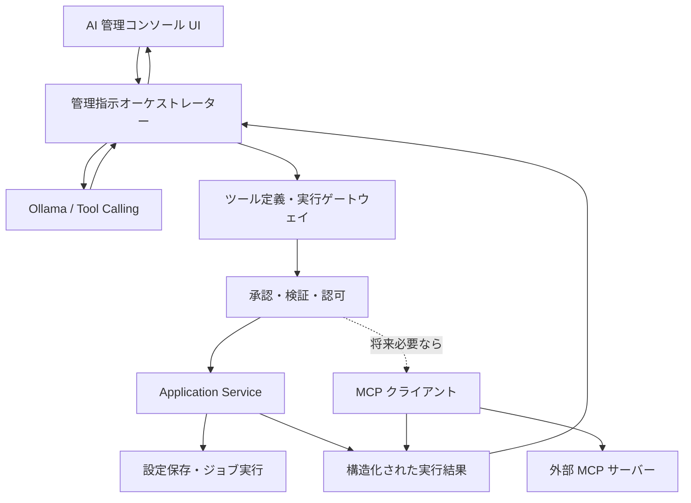

# AI 管理コンソール構想

> **ステータス:** 将来の拡張アイデア（未実装・実装時期未定）  
> **作成日:** 2026-10-29  
> **対象:** Ateliers AI Assistant  
> **位置付け:** 実装仕様ではなく、今後の設計検討に用いる構想メモ

## 1. 背景と目的

**ロードマップとの関係（2026-10-30）:** Phase 5 は情報源拡張基盤・GitHub Releases に範囲を絞り、本構想と新規の MCP / Tool Calling は対象外とする。管理コンソールは引き続き独立した将来候補であり、既存 Phase 6・7 の番号・内容・前提条件を変更しない。

自然言語から情報源の登録・変更、巡回実行、記事のタグ付けなど、通常 UI と同じ Application Service が提供する操作を安全に呼び出す構成を検討する。Tool Calling、実行前確認、権限管理、操作履歴は本構想の検討対象。関心テーマから記事を検索・発見・選別する「AI 情報収集・推薦」や、指定ページの変更を検出する「汎用 Web 監視」とは責務を分ける。未実装の情報発見機能を、自然言語の指示だけで利用可能になるとは扱わない。

Ateliers AI Assistant には、Ollama を利用した AI チャット機能がある。現行チャットの主目的は、モデルの動作確認、応答品質の比較、プロンプトの試行、画像認識の検証である。

一方、将来 Web 情報収集や画面監視などの機能が増えた場合、利用者が自然言語でアプリケーションの設定や操作を指示できると利便性が高い。

例：

> 最近ローカル LLM に興味があるので、関連する新しい情報を定期的に収集するようにして。

本構想では、このような指示を解釈し、アプリケーションが提供する**明示的な操作機能**を通じて設定・実行する「AI 管理コンソール」を検討する。

**現時点では実装しない。** まず各業務機能を通常の UI と Application Service から確実に操作できる状態にする。

## 2. 基本方針

1. **既存の AI チャットと役割を分離する。** AI チャットはモデル検証用として維持し、管理コンソールは設定変更・操作実行・結果確認を担う。
2. **LLM は操作の提案者・呼び出し元であり、権限の最終判断者ではない。** 入力検証、認可、永続化、実行はアプリケーション側で行う。
3. **MCP は選択肢であり必須条件ではない。** アプリ内ツールは C# の Application Service を直接呼び出せる。外部クライアントとの相互運用が必要になった場合に MCP を導入する。
4. **状態変更は原則として確認後に実行する。** 特に削除、停止、外部送信などの影響が大きい操作は明示的な承認を必須とする。
5. **実行結果はサービスの応答を正とする。** LLM の自然言語による「完了しました」という回答だけで成功と判定しない。
6. **機能の自動実装とは区別する。** 管理コンソールが行うのは、あらかじめ実装・公開された操作の実行である。AI に新規コードを書かせて自動実行する機能は別構想とする。

## 3. 想定ユースケース

| 指示例 | 想定する処理 | 確認事項 |
| --- | --- | --- |
| 「ローカル LLM のニュースを収集して」 | 監視テーマを提案し、承認後に登録 | テーマ、情報源、頻度、通知方法 |
| 「C# の情報収集を毎日から週1回にして」 | 既存設定を検索し、頻度を変更 | 対象テーマと変更内容 |
| 「今すぐ収集を実行して」 | 既存テーマの即時実行を要求 | 対象テーマ、重複実行の有無 |
| 「最近の収集状況を教えて」 | 最終実行日時・成功／失敗を取得 | 参照可能な実行履歴 |
| 「C# の監視を停止して」 | 対象設定を確認して無効化 | 削除と一時停止の区別 |
| 「このリポジトリを監視対象に追加して」 | 情報源の登録操作を提案し、承認後に実行 | 対象リポジトリ、巡回設定、公開する操作範囲 |
| 「この記事に調査タグを付けて」 | 対象記事を特定し、既存のタグ付与操作を呼び出す | 対象記事とタグ名、確認・権限の方針 |

曖昧な指示は推測だけで確定せず、必要な項目を質問する。初期値を使う場合は、実行前に提示する。

## 4. 構成イメージ



### 責務分担

| 構成要素 | 主な責務 |
| --- | --- |
| 管理コンソール UI | 指示入力、提案内容表示、承認・拒否、操作結果表示 |
| オーケストレーター | LLM とのやり取り、ツール選択、実行手順・回数の制御 |
| ツール定義・実行ゲートウェイ | ツール名・説明・引数スキーマの提供、呼び出しの振り分け |
| 承認・検証・認可 | 入力検証、権限確認、危険操作の承認、実行制限 |
| Application Service | 監視テーマなどの業務操作と整合性保証 |
| MCP アダプター（任意） | 外部ツールや外部クライアントとの接続 |

**設計原則:** ViewModel からデータベースを直接更新しない。LLM から任意の SQL、シェルコマンド、ローカルファイル操作を無制限に実行させない。

内部サービスの直接呼び出しも外部 MCP の利用も、アプリ側の承認・検証・認可・実行制限を通す。図は候補となる責務の関係を示すもので、配置するプロセスや専用プロジェクトの作成を確定するものではない。

## 5. 初期ツール候補

Web 情報収集機能が完成した後、以下のような小さなツール群から検証する。

| ツール名（仮） | 処理 | 変更操作 |
| --- | --- | --- |
| `list_monitoring_topics` | 監視テーマの一覧取得 | いいえ |
| `get_monitoring_status` | 実行状況・最終結果の取得 | いいえ |
| `create_monitoring_topic` | テーマと収集条件の登録 | はい |
| `update_monitoring_topic` | テーマ設定の変更 | はい |
| `disable_monitoring_topic` | 監視の無効化 | はい |
| `run_monitoring_now` | 情報収集の即時実行 | はい（外部通信・負荷あり） |
| `delete_monitoring_topic` | 監視テーマの削除 | はい（破壊的） |

初期検証では参照系と登録系の少数に限定する。削除などの破壊的操作は後から追加する。

## 6. 想定する操作フロー

1. 利用者が自然言語で依頼する。
2. LLM が必要な操作と引数の候補を作る。
3. アプリケーションが引数をスキーマおよび業務ルールで検証する。
4. 不足項目や曖昧さがあれば利用者に確認する。
5. 変更内容のプレビューを表示し、承認を得る。
6. Application Service が処理を実行する。
7. 実行結果を構造化データで受け取り、成功・失敗を表示する。
8. 操作履歴に、指示、提案、承認、実行結果、エラーを記録する。

例：

```text
ユーザー: ローカル LLM の情報収集を始めて。
AI: 次の設定を提案します。
    テーマ: ローカル LLM
    対象: モデルのリリース・機能更新
    頻度: 毎日（仮設定）
    通知: アプリ内
    この内容で登録しますか？
ユーザー: はい。
アプリ: create_monitoring_topic を実行
AI: 登録が完了しました。（実行結果に基づく）
```

## 7. セキュリティ・運用上の検討事項

- **プロンプトインジェクション:** Web ページ、RSS、ツール結果などの外部情報を命令として扱わない。外部テキストから設定変更を直接実行しない。
- **承認:** 変更系は承認を基本とし、破壊的操作は必須とする。将来、低リスク操作だけ承認省略を検討する。
- **最小権限:** 公開するツールを明示的に限定し、機能ごとに操作可能範囲を制限する。
- **実行制限:** ツール呼び出し回数、タイムアウト、並列実行、再試行、重複登録を制御する。
- **監査:** 誰の指示で何を変更したか、承認の有無、変更前後の値、実行結果を記録する。
- **機密情報:** API キーや資格情報を LLM に渡さず、サービス側で管理する。
- **モデル差:** 小規模ローカルモデルではツール選択・引数生成の精度が不安定な可能性があるため、実モデルで検証する。
- **共有モデル:** Ollama のモデル利用は他機能と競合し得る。将来のモデル管理ではチャット単位のロード・アンロードから共通利用管理への見直しが必要となる可能性がある。

## 8. MCP の位置付け

MCP は、ツールを標準化された方法で公開・利用するための候補である。

- **アプリ内完結:** 内部ツールインターフェースから Application Service を直接呼ぶ方が単純。
- **外部連携が必要:** MCP クライアントとして外部サーバーを利用することを検討する。
- **他の AI クライアントから操作したい:** 必要な機能だけを MCP サーバーとして公開することを検討する。

MCP サーバーの存在だけでは自律的なツール実行は成立しない。Ollama の Tool Calling、オーケストレーター、実行制御、承認、エラー処理を別途実装する必要がある。

現行の `IChatService` / `OllamaChatService` は原文・画像による会話と回答本文のストリーミングを対象とし、ツール呼び出しの通信・実行は未実装である。既存チャットをそのまま管理コンソールとして扱わず、必要な通信契約と実行制御は PoC の着手時に検討する。

## 9. 実装を見送る理由

構想作成時には Web 情報収集などの管理対象機能と設定 API が十分に確立していなかった。先に管理チャットを作ると、未確定の業務仕様を自然言語 UI に合わせて設計することになり、不要な抽象化や手戻りが生じやすい、という判断で見送った。

Phase 4 では通常 UI からの情報源管理・巡回と Worker API、記事の手動タグ等を実装済み。一方、それらを自然言語から公開する操作範囲、Tool Calling、実行前確認・権限・操作履歴は未設計・未実装であり、管理コンソールの着手は別途判断する。Phase 5 の GitHub Releases 対応を理由にこれらを同時実装しない。

また、現在の AI チャットは**モデル検証用途として完成扱い**とし、機能の追加によって責務を曖昧にしない。

## 10. 将来の着手条件と段階案

| 段階 | 内容 | 着手判断 |
| --- | --- | --- |
| A | Web 情報収集を通常 UI から登録・変更・実行できるようにする | 先行して実施 |
| B | Application Service の操作契約と入力検証を安定させる | 先行して実施 |
| C | Ollama Tool Calling による参照系ツールの PoC | 管理対象が実在し、利用価値が確認できたとき |
| D | 登録・変更ツールと承認 UI の PoC | ツール選択精度・安全性を評価できたとき |
| E | 独立した AI 管理コンソール画面 | 自然言語操作が通常 UI より有用と判断できたとき |
| F | MCP 連携・高度な複数ツール実行 | 外部連携や複合操作の具体的需要が生じたとき |

### PoC の評価観点

- 意図したツールと対象設定を正しく選べるか
- 必須項目の不足を適切に質問できるか
- 誤った引数をサービス側で確実に拒否できるか
- 利用者の承認なしに変更が実行されないか
- 実行失敗を成功として報告しないか
- 小規模モデルで実用的な応答時間・安定性が得られるか

## 11. 現時点の結論

AI 管理コンソールを Ateliers AI Assistant の将来機能の候補として記録する。実用性と安全性は前述の PoC で評価し、**今すぐ実装しない**。

まずは Web 情報収集などの業務機能を通常の UI と Application Service で完成させ、その後、既存操作を自然言語から安全に呼び出す仕組みを追加する。MCP は必要性が明確になった段階で採否を決める。

本書は将来の検討材料であり、記載したツール名、画面構成、承認ルール、実装順序は確定仕様ではない。

## 関連ドキュメント

- [AI チャットの実装状況と制約](ai-chat-implementation-status.md): モデル検証用チャットの現行スコープと見送り事項。
- [Web 情報収集](web-monitoring.md): 先行して通常 UI・Application Service から操作可能にする管理対象の候補。
- [アーキテクチャ](../architecture.md): 既存の責務分離と将来の操作入口との関係。
- [ロードマップ](../roadmap.md): 既存 Phase の順序・完了条件と、実装時期未定の構想の区別。
- [未決定事項](../open-questions.md): 着手時に検討する操作範囲・承認・MCP・モデル共有など。
